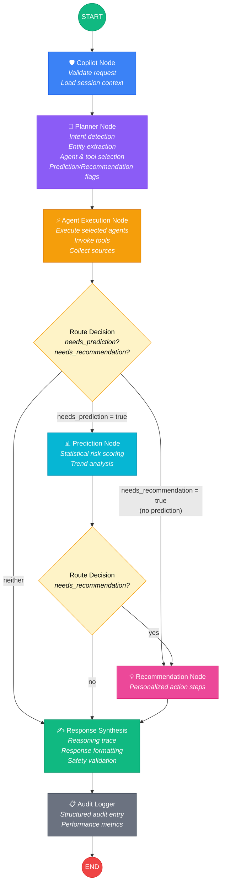
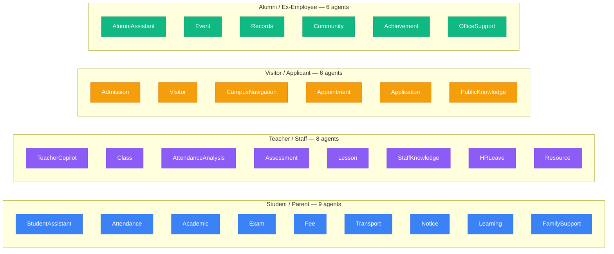
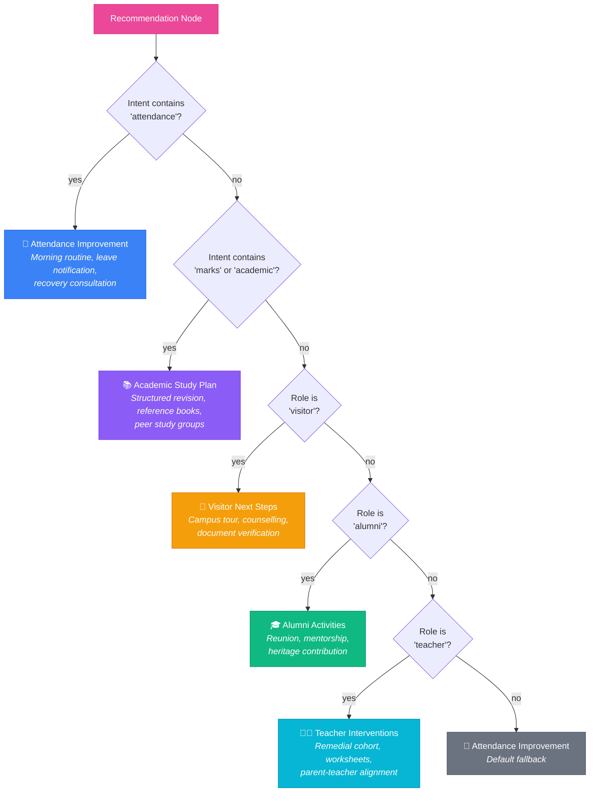
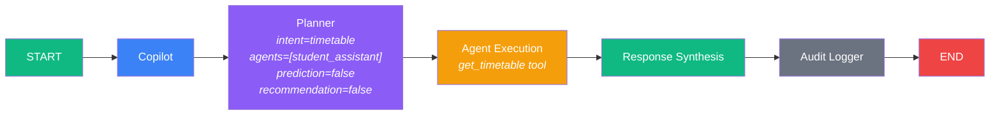
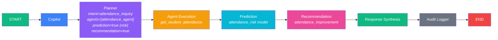
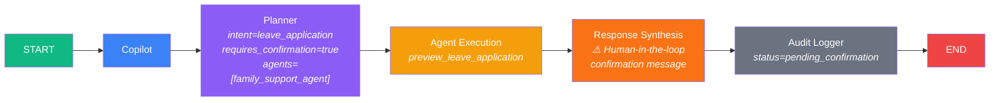
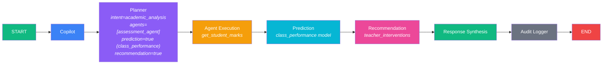
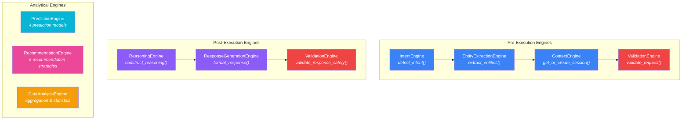
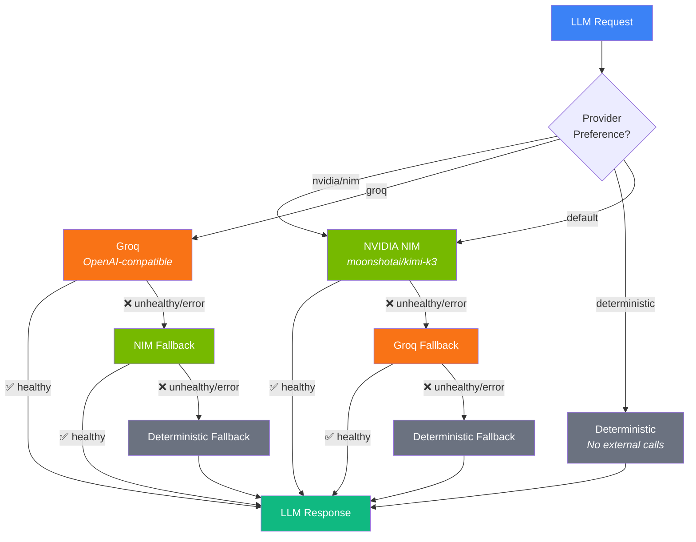

# AI Orchestration Workflow

This document describes the complete AI orchestration flow of the School AI Kiosk Service — from user query intake through dynamic planning, agent execution, prediction, recommendation, response synthesis, and audit logging.

---

## Table of Contents

- [High-Level Architecture](#high-level-architecture)
- [LangGraph Orchestrator](#langgraph-orchestrator)
- [Node-by-Node Walkthrough](#node-by-node-walkthrough)
- [Dynamic Routing Logic](#dynamic-routing-logic)
- [Execution Flow Diagrams](#execution-flow-diagrams)
- [Agent Architecture](#agent-architecture)
- [Engine Pipeline](#engine-pipeline)
- [Provider Fallback Chain](#provider-fallback-chain)
- [State Schema](#state-schema)
- [Example Scenarios](#example-scenarios)

---

## High-Level Architecture

The service follows a layered architecture where each layer has a distinct responsibility:

```
┌─────────────────────────────────────────────────────────────────────────┐
│                          CLIENT REQUEST                                │
│                  (user_id, role, message, session_id)                   │
└──────────────────────────────┬──────────────────────────────────────────┘
                               │
                               ▼
┌─────────────────────────────────────────────────────────────────────────┐
│                        FastAPI Gateway                                  │
│               Routes → Schemas → Validation                             │
└──────────────────────────────┬──────────────────────────────────────────┘
                               │
                               ▼
┌─────────────────────────────────────────────────────────────────────────┐
│                         AICopilot                                       │
│          Session management, graph invocation, memory update            │
└──────────────────────────────┬──────────────────────────────────────────┘
                               │
                               ▼
┌─────────────────────────────────────────────────────────────────────────┐
│                  LangGraph StateGraph Orchestrator                       │
│                                                                         │
│   ┌──────────┐   ┌─────────┐   ┌──────────────┐   ┌──────────────┐    │
│   │ Copilot  │──▶│ Planner │──▶│    Agent      │──▶│  Prediction  │    │
│   │  Node    │   │  Node   │   │  Execution    │   │    Node      │    │
│   └──────────┘   └─────────┘   └──────────────┘   └──────┬───────┘    │
│                                                           │            │
│                                       ┌───────────────────┘            │
│                                       ▼                                │
│                              ┌──────────────┐   ┌──────────────┐       │
│                              │Recommendation│──▶│  Response     │       │
│                              │    Node      │   │  Synthesis    │       │
│                              └──────────────┘   └──────┬───────┘       │
│                                                        │               │
│                                                        ▼               │
│                                                 ┌──────────────┐       │
│                                                 │ Audit Logger │       │
│                                                 └──────────────┘       │
└─────────────────────────────────────────────────────────────────────────┘
                               │
                               ▼
┌─────────────────────────────────────────────────────────────────────────┐
│                         JSON Response                                   │
│        answer, intent, agents_used, sources, reasoning, followups       │
└─────────────────────────────────────────────────────────────────────────┘
```

---

## LangGraph Orchestrator

The orchestrator is built using **LangGraph's `StateGraph`** with 7 nodes and conditional edges. It is defined in `app/graph/graph.py` and compiled once at startup.

### Graph Definition

```
Nodes:
  1. copilot              — Request validation & session context
  2. planner              — Dynamic execution plan generation
  3. agent_execution      — Role-aware agent processing
  4. prediction           — Statistical prediction (conditional)
  5. recommendation       — Personalized recommendations (conditional)
  6. response_synthesis   — Human-friendly answer generation
  7. audit_logger         — Structured audit trail

Edges:
  START → copilot → planner → agent_execution
  
  agent_execution →  prediction          (if needs_prediction)
                  →  recommendation      (if needs_recommendation)
                  →  response_synthesis  (otherwise)
  
  prediction →  recommendation          (if needs_recommendation)
             →  response_synthesis      (otherwise)
  
  recommendation → response_synthesis
  response_synthesis → audit_logger → END
```

### Orchestrator Flow Diagram



---

## Node-by-Node Walkthrough

### 1. Copilot Node (`copilot_node`)

**File:** `app/graph/nodes.py`

**Purpose:** Entry gate — validates the incoming request and initializes session context.

**Steps:**
1. Extract `user_id`, `role`, `tenant_id`, `message`, `session_id` from state
2. Run `ValidationEngine.validate_request()` — checks for empty fields, invalid roles
3. Normalize the role via `SecurityValidator.normalize_role()` (e.g., "student" → "student_parent")
4. Initialize or retrieve session context via `ContextEngine.get_or_create_session()`
5. Return canonical role and success flag

**Output:** `{ role: str, success: bool }` or `{ error: str, success: false }`

---

### 2. Planner Node (`planner_node`)

**File:** `app/graph/nodes.py` → delegates to `app/copilot/planner.py`

**Purpose:** Construct a dynamic execution plan tailored to the query's complexity and the user's role.

**Steps:**
1. Detect intent via `IntentEngine.detect_intent(query, role)` — maps to one of: `attendance_inquiry`, `fees`, `timetable`, `marks_inquiry`, `admissions`, `alumni`, `notices`, `exam`, `leave_application`, etc.
2. Extract entities via `EntityExtractionEngine.extract_entities(query)` — dates, student names, subjects, etc.
3. Select agents and tools based on `(intent, role)` mapping
4. Set conditional flags:
   - `needs_prediction` — triggered by diagnostic keywords: "why", "low", "risk", "trend", "predict"
   - `needs_recommendation` — triggered by guidance keywords: "how to improve", "suggestions", "recommend"
   - `needs_rag` — triggered by policy/circular queries
   - `requires_confirmation` — triggered by sensitive actions (leave, transcript requests)
5. Return the complete `ExecutionPlan`

**Key Design Decision:** Simple queries like "What is my timetable?" set `needs_prediction=false` and `needs_recommendation=false`, ensuring only the minimum components are invoked. Complex queries like "Why is my attendance falling and how can I improve?" activate the full pipeline.

---

### 3. Agent Execution Node (`agent_execution_node`)

**File:** `app/graph/nodes.py`

**Purpose:** Execute only the agents selected by the planner, collect outputs, sources, and tool data.

**Steps:**
1. Retrieve selected agents from the `AgentRegistry` by ID
2. For each agent, call `agent.process(query, intent, entities, user_id, tenant_id)`
3. Each agent internally invokes its registered tools (e.g., `get_student_attendance`, `get_fee_details`)
4. Collect `AgentOutput` objects: findings, tool results, sources, confirmation flags
5. Merge all outputs and return combined results

**Agent Registry:** 29 agents organized by role group:



---

### 4. Prediction Node (`prediction_node`)

**File:** `app/graph/nodes.py`

**Purpose:** Execute statistical prediction **only** when the planner flags `needs_prediction=true`.

**Prediction Models:**

| Model | Input | Output |
|---|---|---|
| `attendance_risk` | Attendance records | Risk level, score, trend |
| `academic_performance` | Marks/grade records | Performance trajectory |
| `class_performance` | Class-wide records | Aggregate class metrics |
| `admission_conversion` | Application records | Conversion probability |

**Output:** `PredictionResult` with `risk_level`, `score`, `trend`, `sufficient_data` flag.

---

### 5. Recommendation Node (`recommendation_node`)

**File:** `app/graph/nodes.py`

**Purpose:** Generate personalized, actionable recommendations **only** when the planner flags `needs_recommendation=true`.

**Strategy Selection:**



**Output:** `RecommendationResult` with `items[]` (title, category, description, priority) and `actionable_steps[]`.

---

### 6. Response Synthesis Node (`response_synthesis_node`)

**File:** `app/graph/nodes.py`

**Purpose:** Synthesize a human-friendly, safe, and grounded response from all preceding outputs.

**Steps:**
1. **Reasoning Trace** — `ReasoningEngine.construct_reasoning()` builds a step-by-step explanation:
   - Intent identification
   - Record retrieval count
   - Prediction results (if applicable)
   - Recommendation summary (if applicable)
   - Synthesis confirmation
2. **Response Formatting** — `ResponseGenerationEngine.format_response()` creates a role-appropriate, readable answer
3. **Safety Validation** — `ValidationEngine.validate_response_safety()` redacts sensitive data and enforces role boundaries
4. **Follow-up Questions** — Suggests contextual next steps

---

### 7. Audit Logger Node (`audit_logger_node`)

**File:** `app/graph/nodes.py`

**Purpose:** Record a structured audit trace for every query processed.

**Audit Entry Fields:**
- `request_id` — Unique request identifier
- `session_id`, `user_id`, `tenant_id`, `role` — Session context
- `intent` — Detected query intent
- `selected_agents`, `selected_tools` — Components invoked
- `model_provider` — Which LLM provider was used
- `latency_ms` — End-to-end processing time
- `success` — Whether the request completed without error
- `final_response_status` — `completed` or `pending_confirmation`

---

## Dynamic Routing Logic

The orchestrator uses two conditional routing functions:

### `route_after_agents(state)`

Called after `agent_execution`. Routes to:
- `prediction` — if `state["needs_prediction"]` is true
- `recommendation` — if `state["needs_recommendation"]` is true (but not prediction)
- `response_synthesis` — if neither flag is set

### `route_after_prediction(state)`

Called after `prediction`. Routes to:
- `recommendation` — if `state["needs_recommendation"]` is true
- `response_synthesis` — otherwise

This ensures the graph takes the **shortest path** for simple queries while enabling the full prediction → recommendation → synthesis pipeline for complex analytical queries.

---

## Execution Flow Diagrams

### Scenario A: Simple Query (Timetable)

> "What is my class timetable?"



**Nodes traversed:** 5 (minimum path)

---

### Scenario B: Diagnostic Query (Attendance Risk)

> "Why is my attendance falling? How can I improve?"



**Nodes traversed:** 7 (maximum path)

---

### Scenario C: Sensitive Action (Leave Application)

> "I want to apply for leave tomorrow for a medical appointment."



**Nodes traversed:** 5 | **Status:** `pending_human_approval`

---

### Scenario D: Teacher Performance Analysis

> "Show me class VIII A performance and suggest interventions."



**Nodes traversed:** 7 (maximum path, teacher context)

---

## Engine Pipeline

The engines are stateless utility classes that perform specific processing tasks:



---

## Provider Fallback Chain

The `ProviderRouter` manages LLM provider selection with automatic cascading fallback:



**Guarantee:** The deterministic provider always succeeds — it requires no external API calls, no credentials, and no network connectivity. Every query returns a safe, grounded answer.

---

## State Schema

The `OrchestratorState` (`app/graph/state.py`) is a `TypedDict` that flows through all nodes:

```
┌──────────────────────────────────────────────────────────────┐
│                     OrchestratorState                        │
├──────────────────────────────────────────────────────────────┤
│ REQUEST PARAMETERS                                           │
│   user_id: str                                               │
│   role: str                                                  │
│   tenant_id: str                                             │
│   session_id: str                                            │
│   message: str                                               │
│   provider_preference: str | None                            │
├──────────────────────────────────────────────────────────────┤
│ PLANNER OUTPUTS                                              │
│   intent: str                                                │
│   entities: dict                                             │
│   selected_agents: list[str]                                 │
│   selected_tools: list[str]                                  │
│   needs_prediction: bool                                     │
│   prediction_type: str | None                                │
│   needs_recommendation: bool                                 │
│   needs_rag: bool                                            │
│   requires_confirmation: bool                                │
│   confirmation_message: str | None                           │
├──────────────────────────────────────────────────────────────┤
│ EXECUTION OUTPUTS                                            │
│   agent_outputs: list[dict]                                  │
│   tool_data: Any                                             │
│   sources: list[dict]                                        │
│   prediction: dict | None                                    │
│   recommendation: dict | None                                │
├──────────────────────────────────────────────────────────────┤
│ RESPONSE & AUDIT                                             │
│   final_answer: str                                          │
│   reasoning_content: str | None                              │
│   followup_questions: list[str]                              │
│   provider_used: str                                         │
│   latency_ms: float                                          │
│   success: bool                                              │
│   error: str | None                                          │
└──────────────────────────────────────────────────────────────┘
```

---

## Example Scenarios

### Intent → Agent → Pipeline Mapping

| User Query | Role | Intent | Agents | Prediction | Recommendation | Path Length |
|---|---|---|---|---|---|---|
| "What is my timetable?" | Student | `timetable` | StudentAssistant | ❌ | ❌ | 5 nodes |
| "Show my fee details" | Parent | `fees` | Fee | ❌ | ❌ | 5 nodes |
| "How is my attendance?" | Student | `attendance_inquiry` | Attendance | ❌ | ❌ | 5 nodes |
| "Why is attendance falling?" | Student | `attendance_inquiry` | Attendance | ✅ risk | ❌ | 6 nodes |
| "How to improve attendance?" | Student | `attendance_inquiry` | Attendance | ✅ risk | ✅ improvement | 7 nodes |
| "Class VIII performance" | Teacher | `academic_analysis` | Assessment | ✅ class | ✅ interventions | 7 nodes |
| "How to improve in Math?" | Student | `marks_inquiry` | Academic | ❌ | ✅ study | 6 nodes |
| "Apply for leave tomorrow" | Student | `leave_application` | FamilySupport | ❌ | ❌ | 5 nodes ⚠️ |
| "Admission process?" | Visitor | `admissions` | Admission | ❌ | ✅ next steps | 6 nodes |
| "Reunion event details" | Alumni | `alumni` | Event | ❌ | ❌ | 5 nodes |
| "Any new circulars?" | Student | `notices` | Notice | ❌ | ❌ | 5 nodes (+ RAG) |

> ⚠️ = Requires human-in-the-loop confirmation before finalization.

---

*Last updated: September 2026*
